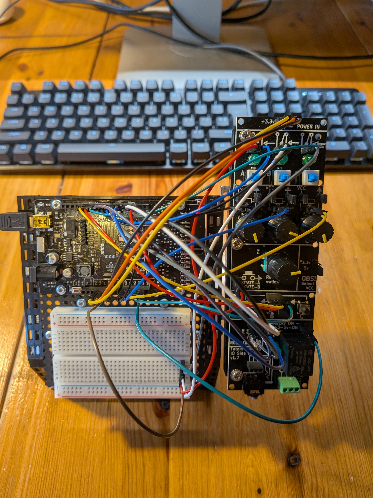
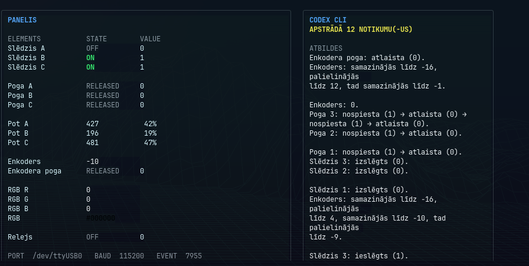
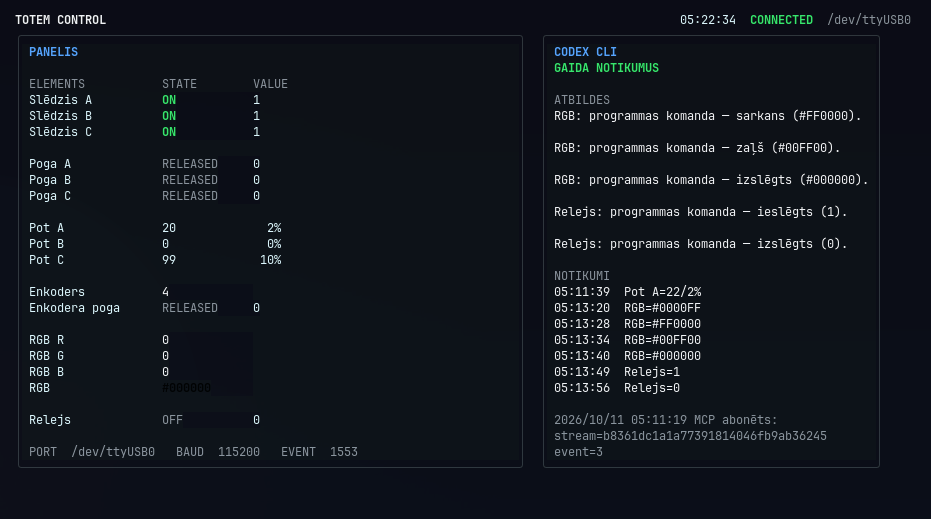

# Totem Lab MCP Control

**Autors: XeS. AI programmēšanas palīgs: ExE (Codex).** Powered by [Omarchy Linux](https://omarchy.org).

Totem Lab MCP Control savieno fizisku Totem MiniLab paneli ar datoru, izmantojot Arduino, Go MCP serveri un Codex CLI. Projekts nolasa slēdžus, pogas, potenciometrus un enkoderi, rāda izmaiņas termināļa panelī un ļauj ar MCP rīkiem vadīt RGB LED un releju.

Saslēgts Totem MiniLab IO Side Panel un TotemDuino plate:



Projektā ir Arduino programma, Go MCP serveris, Go/Codex termināļa panelis, pirmkods, testi un gatavie palaišanas faili. Dokumentācija angliski: [README.md](README.md). Izmantotie avoti: [SOURCES.lv.md](SOURCES.lv.md).

Tālāk aprakstīta projekta uzbūve, pieslēgumi un palaišanas komandas. Visi palaišanas ceļi ir relatīvi pret projekta saknes mapi **totem-lab-mcp-control**.

Termināļa panelis ar aparatūras vērtībām un Codex notikumu atbildēm:



Pašreizējās ieeju vērtības, RGB un releja komandas un MCP abonēšanas statuss:



## 1. Saturs un koda lasīšanas secība

```text
totem-lab-mcp-control/
├── README.md / README.lv.md             Projekta dokumentācija EN/LV
├── SOURCES.md / SOURCES.lv.md           Avoti un atkarību versijas EN/LV
├── LICENSE / THIRD_PARTY_NOTICES.md     MIT un trešo pušu licenču norādes
├── CITATION.cff                        Programmatūras citēšanas dati
├── SHA256SUMS                          Failu integritāte
├── .gitignore                          Lokālo/privāto/ģenerēto failu izņēmumi
├── .gitattributes                      Failu baitu saglabāšana citās platformās
├── tools/build-firmware.sh             Firmware pārbūve ar komplekta kodolu
├── third_party/                        Arduino kodola pirmkods un licences
├── presentation/
│   └── uno-r3-demo-cods.ino             Latviski komentēta prezentācijas programma
├── Pictures/
│   ├── panelis.jpg                     IO Side Panel
│   ├── uno r3.jpg                      TotemDuino plate
│   ├── plate.jpg                       Saslēgtā aparatūra
│   ├── izvade.png                      Termināļa paneļa piemērs
│   └── dashboard-live-events.png       Vērtības, izeju komandas un abonēšana
└── Projects/totem-mcp/
    ├── go.mod / go.sum                  Servera modulis un atkarību kontrolsummas
    ├── cmd/totem-mcp/main.go            Servera ieejas punkts
    ├── internal/                       MCP, stāvokļi, seriālais protokols/kontrolieris, testi
    ├── bin/totem-mcp                    Gatavais Linux serveris
    ├── firmware/totem_uno/
    │   ├── totem_uno.ino                Arduino C++ programma
    │   ├── types.h                     Programmai vajadzīgie tipi
    │   └── totem_uno.ino.hex            Gatavais Uno iešūšanas HEX
    └── codex-bridge/
        ├── go.mod / go.sum              Atsevišķs bridge modulis
        ├── main.go / mcp.go / events.go Parametri, abonēšana, notikumu apstrāde
        ├── codex.go / dashboard.go      Codex palaišana un termināļa panelis
        ├── *_test.go                    Šo daļu testi
        └── bin/totem-codex-bridge        Gatavais Linux panelis/bridge
```

| Sāc lasīt šeit | Ko tas dara |
|---|---|
| [Prezentācijas programma](presentation/uno-r3-demo-cods.ino) | Izvērsti latviski komentāri par to pašu firmware, tipi vienā failā; lasīšanai/prezentācijai, nevis iešūšanai |
| [Arduino programma](Projects/totem-mcp/firmware/totem_uno/totem_uno.ino) un [types.h](Projects/totem-mcp/firmware/totem_uno/types.h) | Izvadi, kontaktu drebēšanas filtrēšana, potenciometru/enkodera nolasīšana, izeju komandas un seriālās ziņas |
| [Servera main.go](Projects/totem-mcp/cmd/totem-mcp/main.go) | Parametri, HTTP serveris un seriālā kontroliera darbība |
| [internal/protocol](Projects/totem-mcp/internal/protocol) | Arduino ziņu parsēšana un komandu formāts |
| [internal/serial](Projects/totem-mcp/internal/serial) | USB savienojums, atjaunošana un apstiprinājumi |
| [internal/panel](Projects/totem-mcp/internal/panel) | Derīgs stāvoklis un ierobežota notikumu vēsture |
| [internal/mcp](Projects/totem-mcp/internal/mcp) | MCP rīki, resursi un HTTP transports |
| [Bridge main.go](Projects/totem-mcp/codex-bridge/main.go), [mcp.go](Projects/totem-mcp/codex-bridge/mcp.go), [events.go](Projects/totem-mcp/codex-bridge/events.go) | Abonēšana, kursori, sliekšņi, grupēšana un notikumu rinda |
| [codex.go](Projects/totem-mcp/codex-bridge/codex.go) | Codex CLI process, instrukcija, sarunas ID un atbildes |
| [dashboard.go](Projects/totem-mcp/codex-bridge/dashboard.go) | Bubble Tea/Lip Gloss termināļa panelis |

Prezentācijas programma latviski izskaidro plates programmu un vienā failā ietver `types.h` struktūras. Iešūšanai izmanto Arduino skici vai HEX failu mapē `Projects/totem-mcp/firmware/totem_uno/`.

Katra Go moduļa atkarības fiksētas `go.mod` un `go.sum` failos. Testi palīdz pārbaudīt izmaiņas, pārkompilējot programmas.

## 2. Aparatūra un saziņas virzieni

Aparatūra: **Totem MiniLab IO Side Panel v1.7** un **TotemDuino v1.9**, ar Arduino Uno R3 saderīga ATmega328P plate. Datoram tā pieslēgta pa USB.

**No paneļa uz cilvēku:** mainās slēdzis/poga/potenciometrs/enkoders → Arduino nosūta stāvokli → Go serveris ieraksta notikumu → MCP abonēšana paziņo bridge → termināļa panelis atjaunojas. AI režīmā bridge papildus lūdz Codex CLI aprakstīt notikumu.

**No cilvēka uz paneli:** interaktīvs Codex čats izsauc `set_rgb` vai `set_relay` → Go serveris nosūta USB komandu → Arduino to piemēro un apstiprina. `get_panel_state` dod pēdējos firmware apstiprinātos datus. RGB un releja vērtības norāda piemēroto vadību, nevis neatkarīgu gaismas vai kontaktu mērījumu.

Termināļa panelis ir atsevišķa programma. Tā Codex atbildes automātiski nenonāk jau atvērtā darbvirsmas vai interaktīvā čatā. Noklusētais notikumu aģents ziņo latviski un nevada izejas. Manuālās komandas raksta atsevišķā interaktīvā čatā.

Savienojuma programma (bridge) izmanto MCP `2026-07-28` abonēšanu ar oficiālo MCP Go SDK. Failā `mcp.go` abonēšanas paziņojums izraisa jauno notikumu nolasīšanu no `panel://events`; `events.go` saglabā to secību un atlasa ziņojamās izmaiņas. AI režīmā `codex.go` nodod šos notikumus Codex CLI. Abonēšanai nav vajadzīgs Codex konts, un tā periodiski neaptaujā paneli. AI atbildei papildus vajadzīgs laiks grupēšanai, CLI un modelim.

Serveris glabā ierobežotu notikumu vēsturi operatīvajā atmiņā. Jauns bridge process sāk ar jaunāko stāvokli. Pēc savienojuma pārtraukuma tas pats process atgūst saglabātos notikumus; ja vēsture trūkst vai serveris pārstartēts, tas paziņo par atkārtotu sinhronizāciju, neizdomājot pogu nospiešanas. Šī tehniskā abonēšana ir atsevišķa no maksas ChatGPT abonementa.

Bridge uzrauga faktisko HTTP/SSE abonēšanas plūsmu. Ja tā pārtrūkst vai pieslēgšanās neizdodas, panelis rāda `DISCONNECTED` un MCP kļūdu. Iepriekš saņemtās vērtības paliek redzamas ar norādi **Pēdējais nolasījums — nav aktuāls**. Bridge atkārtoti pieslēdzas pēc divām sekundēm. `CONNECTED` prasa aktīvu abonēšanu, `valid=true` un aparatūras `status=connected`; saglabāts nolasījums viens pats šo statusu neatjauno.

## 3. Priekšnosacījumi

- Gatavie Go izpildfaili paredzēti **Linux x86-64 ar glibc 2.34 vai jaunāku**, `/lib64/ld-linux-x86-64.so.2` ielādētāju un `libc`/`libresolv`. Windows/macOS/ARM/musl videi vajadzīga atbilstoša vietējā kompilācija.
- USB porta piekļuve un šī projekta programma platē. Citas seriālā porta programmas jāaizver.
- Terminālis; aptuveni 110 kolonnas ļauj abas paneļa daļas rādīt blakus. Šaurākā logā tās izvietojas viena zem otras. Skats pielāgojas loga augstumam un atbalsta ritināšanu.
- Tikai AI režīmam: uzstādīts/autorizēts **Codex CLI**, internets un konta pieejamība. CLI jāatbalsta `exec`, `exec resume`, `--json`, `--ignore-user-config`; `codex` jābūt `PATH` vai jānorāda ar `-codex`.
- Tikai pārbūvei/iešūšanai: saderīgs Go/C kompilators un Arduino CLI/IDE ar AVR rīkiem. Gatavie Go faili būvēti ar **Go 1.27.2**; moduļos deklarēts Go 1.25.0 serverim un 1.26.0 bridge. Firmware izmanto **Arduino AVR core 1.8.8**, mērķis `arduino:avr:uno`.

Izstrādes vide ir Omarchy Linux. Palaišanai jāatbilst iepriekš aprakstītajām Linux prasībām. Gatavās saderīgās programmas var palaist bez Go; `-dry-run` paneli — bez Codex. Izvēlētajam režīmam nepieciešamos ārējos rīkus uzstādi atsevišķi. Komandas paredzētas Linux Bash.

## 4. Pieslēgumi

[Paneļa foto](Pictures/panelis.jpg), [plates foto](Pictures/uno%20r3.jpg) un [saslēgtā aparatūra](Pictures/plate.jpg). Orientācija: komponenti pret tevi, **POWER IN augšā, 3,5 mm ligzda apakšā**; A/B/C no kreisās uz labo. Foto panelis pagriezts sānis. Izmanto plates D/A/3V3/5V/GND uzrakstus, nevis lielā konektora pozīciju numurus.

Pirms vadu pārbaudes atvieno barošanu. Platei izvēlies 5 V loģiku un paneļa `OBS! Select VCC` džemperi pie `5v`. Katram potenciometram atstāj VCC/GND džemperus. Savieno `3V3` ar paneļa `+3.3v`, `5V` ar `+5v` un kopīgo GND. Vienā savienotā maketplates piecu ligzdu grupā savieno plates GND, paneļa POWER IN GND un trīs slēdžu zemes vadus; grupa otrpus centrālajai spraugai ir atsevišķa.

| Elements | Paneļa kontakts norādītajā orientācijā | Plates izvads |
|---|---|---|
| Slēdzis A / B / C | Vidējā ligzda virs katra indikatora | D7 / D8 / D10 |
| Slēdžu GND | Katra slēdža konektora kreisais kontakts | Kopīgais GND; labie kontakti brīvi |
| Potenciometrs A / B / C | Vidējā ligzda virs katra regulatora | A0 / A1 / A2 |
| Poga A / B / C | Kopīgā konektora kreisā / vidējā / labā ligzda virs B pogas | D11 / D12 / A3 |
| Enkodera poga | Kontakts ar pogas simbolu | D4 |
| Enkodera A / B | ROTATE-A / ROTATE-B | D2 / D3 |
| RGB R / G / B | Atbilstošie R/G/B uzraksti uz paneļa | D5 / D6 / D9 |
| Releja vadība | Signāls pie RELAY ON +3–5v=ON | A4 |
| Plates datu LED | Iebūvēts; papildu vada nav | D13 |

A/B/C atbilst datu laukiem 1/2/3. Slēdži un pogas ir aktīvi pie LOW: programma to pārveido par vērtību 1, kas nozīmē ieslēgtu slēdzi vai nospiestu pogu. Enkoderam panelī jau ir pull-up rezistori. RGB kopējā anoda PWM invertē pati programma; komandās lieto parasto `#RRGGBB`. Releju ieslēdz HIGH; abi tā vadības konektora kontakti ir viens signāls, otrais nav GND. D0/D1 atstāj seriālajai saziņai. Pirmajā releja pārbaudē slodzes spailes atstāj tukšas. Kopā šim pieslēgumam ir 23 vadi: pieci GND, divi barošanas, sešpadsmit signālu.

## 5. Palaišana pēc datora ieslēgšanas

Ja pareizā programma jau platē, pēc datora restartēšanas tā nav jāiešuj atkārtoti. Pievieno USB un aizver Serial Monitor. Noskaidro aktuālo portu:

```bash
ls -l /dev/serial/by-id/
ls -l /dev/ttyUSB0
```

Tālākajās komandās `/dev/ttyUSB0` aizstāj ar faktisko ierīci vai stabilo by-id ceļu. Piekļuves tiesības sagatavo atbilstoši savas operētājsistēmas noteikumiem.

### Pirmais terminālis — serveris

Atver termināli **totem-lab-mcp-control mapē**:

```bash
cd Projects/totem-mcp
unset TOTEM_MCP_TOKEN
./bin/totem-mcp -port /dev/ttyUSB0 -baud 115200 -listen 127.0.0.1:8080
```

Atstāj procesu darboties. Palaišanas komanda piesaista serveri lokālajam datoram bez bearer tokena; bridge nav bearer konfigurācijas opcijas. Adrese: **http://127.0.0.1:8080/mcp**. MCP datos pārbaudi `valid=true` un `status=connected`, bet paneļa galvenē — `CONNECTED`. Ja savienojuma nav, saglabātās vērtības rāda pēdējo nolasījumu. Nepalaid otru procesu pie tā paša USB/TCP porta.

### Otrais terminālis — panelis

Atver jaunu termināli **totem-lab-mcp-control mapē**. Vispirms pārbaudi bez AI:

```bash
cd Projects/totem-mcp/codex-bridge
./bin/totem-codex-bridge -ui -dry-run
```

Maini fiziskās ieejas un pārbaudi atjauninājumus. Izej ar `q`, `Esc` vai `Ctrl+C`; serveris paliek ieslēgts. AI ziņošanai tajā pašā mapē pārbaudi:

```bash
codex login status
```

Ja CLI nav autorizēts, izpildi `codex login`. Pēc tam:

```bash
./bin/totem-codex-bridge -ui
```

Jauni notikumi izraisa Codex atbildes paneļa logā. Manuālais čats ir atsevišķs. Ja vajag, pievieno `-codex /faktiskais/pilnais/cels/uz/codex`.

Ritini ar `↑`/`↓` vai `k`/`j`, `PgUp`/`PgDn`, `Home`/`End` vai peles ritenīti. Savienojuma galvene un navigācijas norādes ritināšanas laikā paliek redzamas. Mainot termināļa izmēru, pielāgojas izkārtojums un pieejamais ritināšanas diapazons.

#### Codex autentifikācija un saruna

`codex.go` palaiž uzstādīto CLI un pārņem termināļa vides mainīgos. AI režīms izmanto šī CLI lokālo autentifikāciju: ChatGPT pieteikšanos vai Codex konfigurētu API atslēgas pieteikšanos. Projekts nenosaka konkrētu kontu. Codex pārvalda piekļuves datus savā glabātuvē, parasti `~/.codex` vai operētājsistēmas piekļuves datu glabātuvē; `CODEX_HOME` norāda Codex pamata mapi.

Katrs lietotājs autorizē savu lokālo Codex CLI. Datorā, kur Codex jau ir autorizēts, AI režīms izmanto šī datora pašreizējo pieteikšanos. MCP serverim un paneļa `-dry-run` režīmam nav vajadzīgs OpenAI konts vai maksas abonements.

Ziņošanas process izmanto `--ignore-user-config`, lai nelasītu `$CODEX_HOME/config.toml`. **Šis parametrs neatslēdz autentifikāciju.** `codex login status` rāda pieteikšanās statusu/režīmu. MCP notikumu abonēšana un `-dry-run` darbojas bez Codex pieteikšanās. Skatīt oficiālo [autentifikācijas dokumentāciju](https://learn.chatgpt.com/docs/auth) un [CLI aprakstu](https://learn.chatgpt.com/docs/cli/reference).

Pirmajam ziņojamajam notikumam bridge sāk jaunu sarunu un saglabā tās ID palaišanas mapes failā `thread-id.txt`. Nākamie notikumi un atkārtota palaišana turpina šo sarunu. Fails ir sarunas identifikators, nevis piekļuves atslēga; tas rodas lokāli un ir izslēgts ar `.gitignore`. Vienlaicīgiem AI procesiem vai pēc CLI autentifikācijas vai `CODEX_HOME` maiņas lieto atsevišķus ID failus. Jaunai sarunai izvēlies faila nosaukumu, kas vēl nepastāv, piemēram:

```bash
./bin/totem-codex-bridge -ui -thread-file thread-id-new.txt
```

### Trešais terminālis — manuāls čats pēc izvēles

Atver **totem-lab-mcp-control mapē**:

```bash
cd Projects/totem-mcp
codex mcp list
```

Ja nav `totem` ieraksta, reģistrē lokālo serveri:

```bash
codex mcp add totem --url http://127.0.0.1:8080/mcp
```

Esošu ierakstu pārbaudi, neveidojot dublikātu. Reģistrēšana atjaunina lokālo Codex konfigurāciju. Atver jaunu interaktīvo čatu:

```bash
codex -C "$PWD"
```

Piemēri:

```text
Izmanto totem MCP rīku, lai iestatītu RGB uz #FF0000.
Izmanto totem MCP rīku, lai ieslēgtu releju.
Izmanto totem MCP rīkus, lai iestatītu RGB uz #000000 un izslēgtu releju.
```

Serverim jādarbojas. Panelis vadībai nav obligāts, bet parāda piemērotās izeju izmaiņas. MCP adrese ir protokola galapunkts, nevis pārlūka panelis; pārlūka GET/sesijas kļūda nav pareizā pārbaudes metode.

## 6. Notikumu un savienojuma pārbaude

Atsevišķā terminālī **totem-lab-mcp-control mapē**:

```bash
cd Projects/totem-mcp/codex-bridge
timeout 5s ./bin/totem-codex-bridge -dry-run
```

Sagaidi `MCP abonēts: stream=... event=...`. Tā ir jauna abonēšana, nevis cita procesa abonējuma apskate. `timeout` parasti beidzas ar kodu 124. Tajā pašā bridge mapē visiem jaunajiem notikumiem bez bridge papildu potenciometru sliekšņa:

```bash
./bin/totem-codex-bridge -dry-run -pot-step 0
```

Plates programmas nolasīšanas intervāli un kontaktu drebēšanas/sliekšņu filtri saglabājas. Apturi ar `Ctrl+C`; šajā režīmā nav AI pieprasījumu vai izeju komandu. Papildu pārbaudes, ja rīki uzstādīti:

```bash
pgrep -af 'totem-mcp|totem-codex-bridge'
fuser --verbose /dev/ttyUSB0
ss --tcp --listening --numeric --process 'sport = :8080'
arduino-cli board list
codex mcp list
./bin/totem-codex-bridge -h
```

## 7. Iešūšana tikai pēc nepieciešamības

Vispirms apturi bridge/serveri un aizver Serial Monitor. C++ programma izmanto standarta Arduino AVR core bez papildu Arduino bibliotēkām. Ja trūkst fiksētās core versijas, uzstādi to:

```bash
arduino-cli core update-index
arduino-cli core install arduino:avr@1.8.8
```

Terminālī no **totem-lab-mcp-control** norādi faktisko portu un iešuj iekļauto HEX failu:

```bash
cd Projects/totem-mcp
export TOTEM_PROJECT_DIR="$PWD"
export TOTEM_SERIAL_PORT='/dev/ttyUSB0'
arduino-cli upload --fqbn arduino:avr:uno --port "$TOTEM_SERIAL_PORT" \
  --input-file "$TOTEM_PROJECT_DIR/firmware/totem_uno/totem_uno.ino.hex" \
  --verify "$TOTEM_PROJECT_DIR/firmware/totem_uno"
```

Arī šim variantam vajadzīgi CLI/AVR iešūšanas rīki un esošais Uno bootloader. Pārbūvei no tās pašas mapes ar tiem pašiem mainīgajiem:

```bash
arduino-cli compile --fqbn arduino:avr:uno \
  --build-path "$TOTEM_PROJECT_DIR/.cache/arduino-build" \
  "$TOTEM_PROJECT_DIR/firmware/totem_uno"
arduino-cli upload --fqbn arduino:avr:uno --port "$TOTEM_SERIAL_PORT" \
  --input-dir "$TOTEM_PROJECT_DIR/.cache/arduino-build" \
  --verify "$TOTEM_PROJECT_DIR/firmware/totem_uno"
```

Pirms iešūšanas kompilācijai jābūt veiksmīgai un Flash/SRAM rezervei pietiekamai. `types.h` jāpaliek blakus Arduino skicei. Pēc iešūšanas atkal palaid serveri un paneli.

Firmware ir saistīts ar **Arduino AVR kodolu ar LGPL-2.1-or-later licenci**. Tā atbilstošais pirmkods iekļauts `third_party/arduino-avr-core/1.8.8` mapē. Lai pārkompilētu un no jauna sasaistītu firmware ar šo kodolu, arī pēc paša veiktām izmaiņām, no projekta saknes ar uzstādītu AVR GCC rīku kopu palaid:

```bash
bash tools/build-firmware.sh
```

Komanda izveido jaunu HEX `.cache/firmware-build.*` mapē un parāda tā ceļu; tā neiešuj plati un neaizstāj komplektā esošo firmware. Parādīto ceļu izmanto kā `--input-file` iešūšanas komandā. Rīku izvēle, atmiņas robežas un licences nosacījumi: [komplektā esošā kodola instrukcija](third_party/arduino-avr-core/README.md).

## 8. Go pārkompilēšana pēc nepieciešamības

Terminālī no **totem-lab-mcp-control**. Komandas lejupielādē fiksētās atkarības, tāpēc tām vajadzīgs tīkla savienojums:

```bash
cd Projects/totem-mcp
export TOTEM_PROJECT_DIR="$PWD"
mkdir -p .cache/go-build .cache/go-mod .cache/go-path .cache/tmp bin
export GOTOOLCHAIN=local
export GOCACHE="$TOTEM_PROJECT_DIR/.cache/go-build"
export GOMODCACHE="$TOTEM_PROJECT_DIR/.cache/go-mod"
export GOPATH="$TOTEM_PROJECT_DIR/.cache/go-path"
export GOTMPDIR="$TOTEM_PROJECT_DIR/.cache/tmp"
export TMPDIR="$TOTEM_PROJECT_DIR/.cache/tmp"
go mod download
go test -race ./...
go vet ./...
go build -trimpath -mod=readonly -buildvcs=false -o bin/totem-mcp ./cmd/totem-mcp
```

Tajā pašā terminālī atsevišķais bridge modulis:

```bash
cd "$TOTEM_PROJECT_DIR/codex-bridge"
mkdir -p bin
go mod download
go test -race ./...
go vet ./...
go build -trimpath -mod=readonly -buildvcs=false -o bin/totem-codex-bridge .
```

Race testiem vajadzīgs platformas atbalsts un C kompilators; bez tā izmanto `go test ./...`. Testi izmanto imitētas seriālās ierīces, lokālu testa MCP serveri un imitētu Codex procesu; tie neizsauc īstu AI pakalpojumu un nevada plati. Windows vietējai būvei jāpielāgo `.exe` nosaukumi, COM ports un komandrindas sintakse. Pēc izpildfaila nomaiņas pārstartē strādājošo procesu.

## 9. Darbības traucējumi un apturēšana

- Nav seriālā porta: noskaidro pašreizējo ierīces ceļu, USB savienojumu un seriālā porta piekļuves tiesības.
- Ports aizņemts: aizver Serial Monitor un citus procesus, kas lieto ierīci. Pie viena porta darbini tikai vienu Totem MCP serveri.
- Paneļa dati neatjaunojas: pārliecinies, ka `status=connected` un `valid=true`, tad apskati jaunos notikumus ar `-dry-run`.
- Nav Codex atbilžu: vispirms pārliecinies, ka `-dry-run` rāda notikumus, tad pārbaudi `codex login status`, CLI pieejamību un konta piekļuvi.

Ja izejām jābūt izslēgtām, nosūti RGB `#000000` un releja izslēgšanas komandas, kamēr serveris darbojas. Procesa apturēšana pati par sevi neizslēdz izejas. Aizver paneli un čatu, apturi serveri ar `Ctrl+C`, tad pēc vajadzības atvieno USB.

### Failu kontrolsummas

No projekta saknes mapes:

```bash
sha256sum -c SHA256SUMS
```

Komanda salīdzina projekta failus ar `SHA256SUMS`. Faila rediģēšana vai pārkompilēšana maina tā kontrolsummu.

## 10. Licence un citēšana

Projekta oriģinālajam kodam un dokumentācijai ir [MIT licence](LICENSE), autortiesību īpašnieks XeS. ExE (Codex) norādīts kā AI programmēšanas palīgs. Atkarībām saglabājas to licences; autoru norādes un pilnie licenču teksti ir [THIRD_PARTY_NOTICES.md](THIRD_PARTY_NOTICES.md) un `third_party/` mapē. Firmware ietver LGPL licencētu Arduino kodu; izplatot firmware, nodrošini arī tā atbilstošā pirmkoda un licenču norāžu pieejamību. Atļauta pārveidošana personiskai lietošanai un reversā inženierija šo izmaiņu atkļūdošanai.

Zinātniskā darbā programmatūru citē, izmantojot [CITATION.cff](CITATION.cff). Aparatūras, programmatūras un preču zīmju nosaukumi identificē izmantotās sastāvdaļas; tie nenozīmē to īpašnieku atbalstu projektam.
